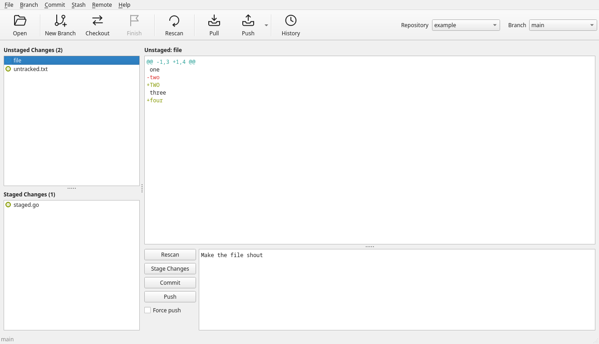
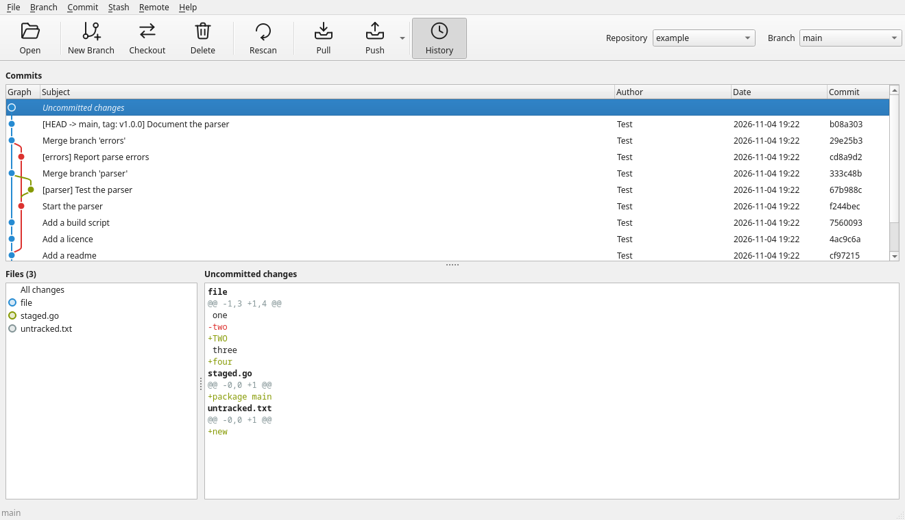

#  Delta

**A fast, friendly git GUI for Linux and macOS.** Delta puts `git gui` and
`gitk` in one window: stage and commit your changes, then press `Ctrl+H` to
browse the history as a graph, and press it again to go back. It is a native
Qt 6 app written in Go, through the [miqt](https://github.com/mappu/miqt)
bindings.





## Why Delta

* **It never makes you wait.** Git runs in the background, never in the
  window's way, and reads that don't depend on each other run at once: a rescan
  reads the status, branches, stashes and last commits side by side, and diffs
  are worked out off screen. Quick work doesn't even flicker the progress bar.
* **Changes and history in one place.** Colour-coded circles show what happened
  to each file, the diff follows the file you choose (or drag over), and a
  double-click stages or unstages it. The history draws every branch and merge
  as a graph, reads more as you scroll, and starts with a row for what you
  haven't committed yet.
* **Interactive rebase without the editor.** Right-click a commit, then drag
  commits into order and pick, fixup, reword, edit, squash or drop each from a
  dropdown, with the message right below. When git stops, the Branch menu has
  Continue, Skip and Abort.
* **The everyday fixes, built in.**
  * **Quick Fix** folds a forgotten change into the last commit, or the last
    commit into the one before.
  * **Uncommit** takes the last commit back into your files.
  * **Finish Branch** checks out `main`, pulls, and deletes the branch you were
    done with, in one go.
* **Safe by default.** Anything that rewrites history or throws work away asks
  first, with No as the answer, and says when what it rewrites has been pushed.
  Force pushes use `--force-with-lease`, and Discard All Changes tells you how
  many files it will put back and delete.
* **Stashes that explain themselves.** Stash with a message and untracked files
  if you like. When applying a stash clashes, it keeps the stash, marks the
  conflicts in orange, and tells you what to do.
* **Quick to get around.** Every repository you open is a dropdown away, beside
  a dropdown of branches. Running `delta` again brings back the window that is
  open rather than starting a second copy, and opens the repository you named.
* **Yours to style.** Light, dark or the system's theme, and any font for the
  code. Every colour, from the diff's lines to the change circles, starts as
  Solarized's and can be changed.
* **It never hangs.** Git and ssh never wait on a hidden password prompt: Delta
  uses your credential helper or ssh agent, or shows git's error.
* **Easy to install.** One program, released as an AppImage for Linux and an
  app for Apple Silicon Macs.

## Running

```sh
delta [folder]
```

Only one copy of Delta runs at a time. Starting it again brings back the
window there is, opening the repository the new copy would have opened.

It opens the repository holding the folder given. Without one, it opens the
repository the current folder is in, or else the one you last opened, or else
none, until you open one from **File > Open Repository…** or **Repository** in
the toolbar. It always starts on the changes, with the first unstaged file
chosen, if there is one, as it is whenever a repository is opened.

## The toolbar

| Button | Does |
| ------ | ---- |
| **Open** | Opens a repository, as **File > Open Repository…** (`Ctrl+O`) does. |
| **New Branch** | Makes a branch, and checks it out if you like. |
| **Checkout** | Switches to another branch. |
| **Finish** | Finishes with the current branch: checks out `main` (or `master`), pulls into it, and deletes the branch, after asking. |
| **Rescan** | Reads the state of the repository again. |
| **Pull** | Pulls into the current branch. |
| **Push** | Pushes the current branch, setting its upstream on the first push. Its arrow opens a **Force push** option. |
| **History** | Shows the history in place of the changes until it is pressed again, as **Branch > Show History** (`Ctrl+H`) does. |

Under the toolbar, a progress bar the width of the window shows while anything
takes more than a moment: a command, reading the status, a diff or the history,
or a fetch.

## Repository and Branch

At the toolbar's right, **Repository** lists every repository you have opened,
including one Delta was started in, by the names of their folders in
alphabetical order. Hover over one to see its whole path. Choosing one opens it.
The list is saved with the settings, with each repository in it only once, and
holds up to 20 (a setting), the one opened longest ago going first. The
dropdowns grow to fit a long name, up to a limit, and narrow when the window
does.

**Branch** lists the open repository's local branches, with the current one
chosen. Choosing another checks it out.

## The changes

* **Unstaged Changes** and **Staged Changes**, in the sidebar, list the changed
  files, each with a circle in a colour for what happened to it, Solarized's to
  start with and set in **Settings**. The history's list of files has the same
  circles, and says what happened to a file when you hover over it.

  | Circle | Change |
  | ------ | ------ |
  | Blue   | Modified |
  | Green  | Added |
  | Red    | Deleted |
  | Violet | Renamed |
  | Cyan   | Copied |
  | Yellow | Type changed |
  | Grey   | Untracked |
  | Orange | In conflict |

* Choose a file to see its **diff**, with added lines in green and removed lines
  in red, and without git's file headers. Drag over the list to see each file in
  turn. Double-click a file to stage or unstage it. Ctrl and shift select several.
* The **message pane** holds the commit message, with **Rescan**, **Stage
  Changes**, **Commit** and **Push** beside it. **Stage Changes** stages
  everything listed; when everything is staged it is **Unstage Changes**, which
  unstages it all.
* **Force push**, beside them and in the toolbar Push's menu, makes the Push
  buttons force the next push, after asking you first. The two are ticked
  together, it is remembered between runs, and a successful push clears it.
  `Ctrl+P` always pushes without forcing, and **Remote > Force Push…** always
  forces.

**Commit > Quick Fix…** (`Ctrl+Shift+Q`) folds a quick change into the last
commit. With changes not committed, it puts all of them, untracked
files included, into the last commit, keeping its message. With nothing to
commit, it folds the last commit into the one before it, keeping that one's
message. It asks first every time, naming the commits, as it rewrites the
branch's history, and says so if they have been pushed, as the branch will then
need a force push.

**Commit > Uncommit…** takes the last commit back, after asking: its changes are
left in your files, unstaged, as if you had just made them, along with anything
you had staged. It says so if the commit has been pushed, as the branch will then
need a force push. The first commit of a branch is taken back to none, its files untracked.
A merge can't be uncommitted.

Forcing uses `--force-with-lease`: git refuses if the remote has commits you have
not fetched, so you can't overwrite someone else's work without seeing it.

**Branch > Discard All Changes…** puts the branch back as if it had just been
checked out: every change not committed, staged or not, is undone, new files and
folders are deleted, and a merge in progress is abandoned. Commits, and files
git ignores, are kept. It asks first, saying how many files it will put back and
delete, as it can't be undone.

## The history

The commits of the current branch are listed at the top, newest
first, with a graph at the left drawing how they branch and merge, and any
branches and tags at them in brackets. They are read 500 at a time (a setting),
and more as you scroll to the end. If anything is not committed yet, an
**Uncommitted changes** row comes first, staged, unstaged and untracked together.

Below the commits, choose one to see the files it changed on the left, and its
message and diff on the right. Choose a file to go to its place in the diff. A
merge is shown as what it changed against its first parent.

A diff over 4 MiB, of the changes or in the history, is cut off with a note
saying so.

### Interactive rebase

Right-click a commit and choose **Rebase from here…** to rewrite it and the
commits after it. A dialog lists them oldest first, as git applies them, each
with a dropdown of what to do with it:

| Action | Does |
| ------ | ---- |
| Pick   | Keeps the commit. |
| Fixup  | Folds the commit into the one above, keeping only that message. |
| Reword | Keeps the commit with a new message: the message below the list becomes editable. |
| Edit   | Stops after the commit, so that you can change it. |
| Squash | Folds the commit into the one above, keeping both messages. |
| Drop   | Leaves the commit out, after asking you first. |

Drag commits into the order to apply them in, one or several at a time. Below
the list is the chosen commit's message. The list shows only the start of each
commit's first line, and its tooltip the start of its message, so that long
messages fit; the message below has all of it. The dialog opens at the size it
was last closed at.

Git needs a clean work tree, so commit or stash your changes first. A range
holding a merge can't be rebased this way. When the rebase stops, at a commit to
edit or one that doesn't apply cleanly, the status bar says so and how far it
has got. Resolve and stage in the changes, then choose **Continue Rebase** from
the Branch menu. Anything staged at a commit to edit goes into that commit.
**Skip Commit** leaves out the commit it stopped at, and **Abort Rebase** puts
the branch back as it was.

## Menus

| Menu   | Items | Shortcuts |
| ------ | ----- | --------- |
| File   | Open Repository, Settings, Quit | `Ctrl+O`, `Ctrl+,`, `Ctrl+Q` |
| Branch | New Branch, Checkout, Finish Branch, Rename, Delete, Show History, Merge, Abort Merge, Continue Rebase, Skip Commit, Abort Rebase, Discard All Changes | New Branch `Ctrl+N`, Checkout `Ctrl+B`, Show History `Ctrl+H`, Merge `Ctrl+M`, Discard All Changes `Ctrl+Shift+D` |
| Commit | Rescan, Stage Changes, Stage Selected, Unstage Selected, Unstage All, Commit, Uncommit, Quick Fix | `F5`, `Ctrl+Shift+S`, `Ctrl+S`, `Ctrl+U`, `Ctrl+Shift+U`, Commit `Ctrl+Return`, Uncommit `Ctrl+Shift+Return`, Quick Fix `Ctrl+Shift+Q` |
| Stash  | Stash Changes, Apply Stash, Pop Stash, Drop Stash | Stash Changes `Ctrl+Shift+Z` |
| Remote | Fetch, Pull, Push, Force Push, Add Remote, Rename Remote, Change URL, Remove Remote | Fetch `Ctrl+Shift+F`, Pull `Ctrl+Shift+L`, Push `Ctrl+P`, Force Push `Ctrl+Shift+P` |
| Help   | About | `Ctrl+I` |

**Finish Branch…** is for when you are done with a branch: it checks out `main`,
or `master` if there is no `main`, pulls into it, and deletes the branch you were
on. It asks first, and won't start with changes not committed. If the pull
fails, it stops there and keeps the branch. If git won't delete the branch, as
its commits are not merged, it asks whether to delete it anyway.

**New Branch** corrects a name git would refuse when you click OK: spaces become
hyphens, and what git doesn't allow in a branch's name is taken out, so
`my new branch?` becomes `my-new-branch`.

**Checkout** lists every local branch by name, with the current one chosen. Tick
**Include remote branches** to fetch and list the remote ones too: checking one
out makes a local branch that tracks it.

Deleting a branch asks first, and asks again if it has commits that have not been
merged.

## Stashes

**Stash > Stash Changes…** puts everything uncommitted aside, staged or not,
with a message if you like, and untracked files too if you tick **Include
untracked files**. **Apply Stash…** and **Pop Stash…** put a stash's changes back,
with what was staged staged again; Pop then drops the stash. **Drop Stash…**
deletes one, after asking. None of them can be used during a merge or rebase.

If a stash clashes with what was committed since, what doesn't clash is applied,
the files that do are left in conflict, shown in orange, and the stash is kept,
even by Pop: resolve them and stage them, then drop it. If what was staged can't
be put back as it was, Delta asks whether to apply it with everything unstaged.
If changes or untracked files are in the way, nothing is applied and git's
message says which.

## Settings

The **General** tab of **File > Settings…** sets:

- How many commits of the history are read at a time: 500 to start with, from
  50 to 10,000.
- How many repositories opened are remembered: 20 to start with, from 1 to 100.

The **User interface** tab sets:

- The theme: follow the system, light or dark.
- The font and size of the code (diffs and the commit message). Any installed
  font can be chosen.

Its table of colours sets every colour Delta gives itself, each starting as one
of Solarized's:

- The diff's added lines, removed lines and hunk headers (the grey
  `@@ -1,6 +1,7 @@`).
- The circle beside a changed file, for each thing that can happen to it.
- The progress bar under the toolbar.

The settings are kept in `delta/settings.json` under the system's configuration
folder (`~/.config` on Linux), along with the repositories you have opened and
the last of them, whether **Force push** is ticked, the size of the window and
its panes, which are saved when it closes, and the size of the interactive rebase
dialog.

## Desktop entry

On Linux, Delta adds itself to the desktop's applications every time it
starts, so that it can be opened from the menu and kept in a dock. It writes
`~/.local/share/applications/delta.desktop` and its icon to
`~/.local/share/icons/hicolor/256x256/apps/delta.png` (or under
`$XDG_DATA_HOME`). The entry starts the copy that ran last, wherever it is, which
is the AppImage if it was run from one.

## Passwords

Delta never prompts for a password itself. Git and ssh run without a
terminal, so remote operations need a credential helper, an ssh agent or
`SSH_ASKPASS`; otherwise they fail with git's error rather than hanging.

## Requirements

Running it needs `git` 2.31 or later. Building it from source also needs:

- Go 1.27.3 or later
- A C++ compiler (GCC or Clang)
- `pkg-config`
- The Qt 6 development files of Qt Widgets

These commands install them:

```sh
# Arch, CachyOS, Manjaro
sudo pacman -S git go gcc pkgconf qt6-base

# Debian, Ubuntu
sudo apt install git golang-go build-essential pkg-config qt6-base-dev

# Fedora
sudo dnf install git golang gcc-c++ pkgconf-pkg-config qt6-qtbase-devel

# openSUSE
sudo zypper install git go gcc-c++ pkgconf-pkg-config qt6-base-devel

# macOS, with Homebrew and the Xcode Command Line Tools
brew install go pkgconf qtbase
```

If your distribution's Go is too old, get a newer one from
[go.dev/dl](https://go.dev/dl/). To check that Qt can be found, run
`pkg-config --modversion Qt6Widgets`, which should print a version starting
with 6.

## Building

The first build compiles all of the Qt bindings, which takes several minutes and
prints compiler warnings from the Qt headers that can be ignored. Later builds
take a few seconds.

```sh
make build        # builds ./delta
make run          # builds and runs it
make install      # installs it in $GOBIN or $(go env GOPATH)/bin, to run from anywhere
make test         # runs the tests
make race         # runs the tests with the race detector
make vet          # runs go vet
make screenshots  # redraws the pictures in docs/
make icons        # redraws the macOS icon in packaging/, after the icon changes
make appimage     # builds the AppImage
make macos        # builds the macOS app, on a Mac
make clean        # removes ./delta and build/
```

To change the icon, replace `internal/appicon/appicon.png` with another 256×256
PNG and run `make icons`.

## Releases

Pushing a tag starting with `v` runs the GitHub workflows, which build both
packages and attach them to a release of that name:

```sh
git tag v1.0.0 && git push origin v1.0.0
```

They can also be run by hand from the repository's Actions tab, which leaves the
package as an artifact of the run to download.

### AppImage for Linux

`Delta-*-x86_64.AppImage` is one file with Qt inside it. Make it
executable and run it. It works under X11 and Wayland, on systems with glibc 2.35
or later, such as Ubuntu 22.04 and Debian 12. `git` is not included.

`make appimage` runs the same script locally, but the result only runs on systems
at least as new as the one that built it. The releases are built on Ubuntu 22.04
for that reason.

### macOS app

`Delta-*-arm64.dmg` is for Macs with Apple Silicon. Open it and drag Delta
into Applications.

The app is not signed with an Apple Developer ID or notarised, so macOS won't
open it the first time. Do one of these once:

- Choose Open Anyway under System Settings > Privacy & Security.
- Run this in Terminal:

  ```sh
  xattr -dr com.apple.quarantine "/Applications/Delta.app"
  ```

## Licence

GNU General Public License version 3. See [LICENSE](LICENSE).
