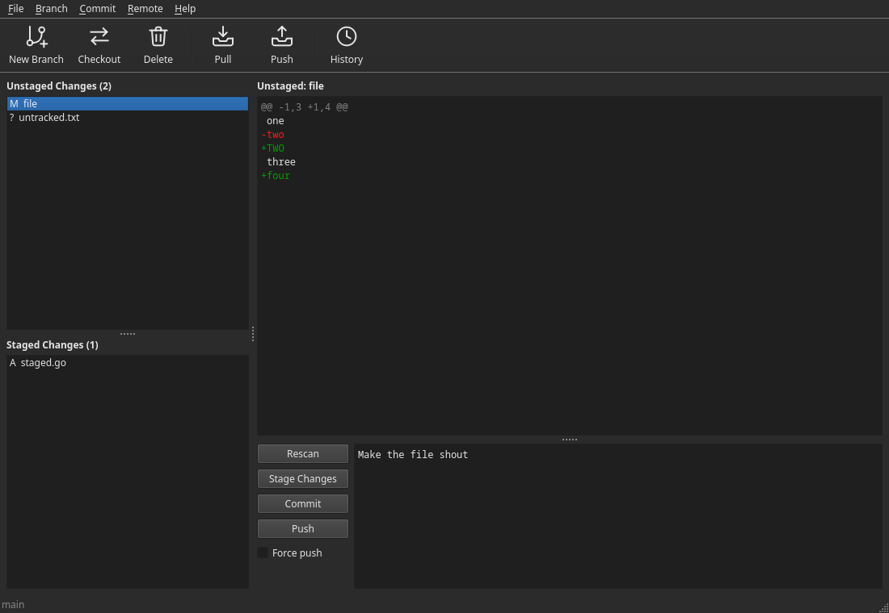

#  Delta

A graphical user interface for git, in the spirit of `git gui` and `gitk`.
Stage and commit your changes, and browse the history as a graph. It is
written in Go with Qt 6, through the [miqt](https://github.com/mappu/miqt)
bindings, and runs on Linux and macOS.




## Running

```sh
delta [folder]
```

It opens the repository holding the folder given. Without one, it opens the
repository the current folder is in, or else the one last open. You can open
another from **File > Open Repository…**.

It starts on the changes. A toolbar under the menus has **New Branch**,
**Checkout** and **Delete**, then **Pull** and **Push**, then **History**, which
shows the history in place of the changes until it is pressed again.

## The changes

* **Unstaged Changes** and **Staged Changes**, in the sidebar, list the changed
  files, each with a letter for what happened to it: `M` modified, `A` added,
  `D` deleted, `R` renamed, `C` copied, `T` type changed, `?` untracked, `U` in
  conflict.
* Choose a file to see its **diff**, with added lines in green and removed lines
  in red, and without git's file headers. Drag over the list to see each file in
  turn. Double-click a file to stage or unstage it. Ctrl and shift select several.
* The **message pane** holds the commit message, with these beside it:
  * **Rescan** reads the state of the repository again.
  * **Stage Changes** stages everything in the unstaged list, untracked files
    included. When everything is staged it becomes **Unstage Changes**, which
    unstages everything.
  * **Commit** commits what is staged.
  * **Push** pushes the current branch, setting its upstream on the first push.
  * **Force push** makes the next push a forced one, after asking you first.

Forcing uses `--force-with-lease`: git refuses if the remote has commits you have
not fetched, so you can't overwrite someone else's work without seeing it.

## The history

As in `gitk`, the commits of the current branch are listed at the top, newest
first, with a graph at the left drawing how they branch and merge, and any
branches and tags at them in brackets. More are read as you scroll to the end.
If anything is not committed yet, an **Uncommitted changes** row comes first,
staged, unstaged and untracked together.

Below the commits, choose one to see the files it changed on the left, and its
message and diff on the right. Choose a file to go to its place in the diff. A
merge is shown as what it changed against its first parent.

### Interactive rebase

Right-click a commit and choose **Interactive Rebase from Here…** to rewrite it
and the commits after it. A dialog lists them oldest first, as git applies them,
each with a dropdown of what to do with it:

| Action | Does |
| ------ | ---- |
| Pick   | Keeps the commit. |
| Fixup  | Folds the commit into the one above, keeping only that message. |
| Reword | Keeps the commit with a new message: the message below the list becomes editable. |
| Edit   | Stops after the commit, so that you can change it. |
| Squash | Folds the commit into the one above, keeping both messages. |
| Drop   | Leaves the commit out, after asking you first. |

Drag commits into the order to apply them in, one or several at a time. Below
the list is the chosen commit's message. The list shows only the start of each
commit's first line, and its tooltip the start of its message, so that long
messages fit. The message has all of it. The dialog opens at the size it was
last closed at.

Git needs a clean work tree, so commit or stash your changes first. A range
holding a merge can't be rebased this way. When the rebase stops, at a commit to
edit or one that doesn't apply cleanly, the status bar says so and how far it
has got. Resolve and stage in the changes, then choose **Continue Rebase**
from the Branch menu. Anything staged at a commit to edit goes into that commit.
**Skip Commit** leaves out the commit it stopped at, and **Abort Rebase** puts
the branch back as it was.

A diff over 4 MiB, of the changes or in the history, is cut off with a note
saying so.

## Menus

| Menu   | Items | Shortcuts |
| ------ | ----- | --------- |
| File   | Open Repository, Settings, Quit | `Ctrl+O`, `Ctrl+,`, `Ctrl+Q` |
| Branch | New Branch, Checkout, Rename, Delete, Merge, Abort Merge, Continue Rebase, Skip Commit, Abort Rebase | `Ctrl+N`, `Ctrl+B`, Merge `Ctrl+M` |
| Commit | Rescan, Stage Changes, Stage Selected, Unstage Selected, Unstage All, Commit, Push, Force Push | `F5`, `Ctrl+Shift+T`, `Ctrl+T`, `Ctrl+U`, `Ctrl+Shift+U`, `Ctrl+Return`, `Ctrl+P`, `Ctrl+Shift+P` |
| Remote | Fetch, Pull, Push, Force Push, Add Remote, Rename Remote, Change URL, Remove Remote | Fetch `Ctrl+Shift+F`, Pull `Ctrl+Shift+L` |
| Help   | About | `Ctrl+I` |

Deleting a branch asks first, and asks again if it has commits that have not been
merged.

## Settings

The **User interface** tab of **File > Settings…** sets:

- The theme: follow the system, light or dark.
- The font and size of the code (diffs and the commit message). Any installed
  font can be chosen.
- The colours of added lines, removed lines and hunk headers (the grey
  `@@ -1,6 +1,7 @@`), in a table.

The settings are kept in `delta/settings.json` under the system's
configuration folder (`~/.config` on Linux), along with the size of the window
and its panes, which are saved when it closes, and of the
interactive rebase dialog.

## Desktop entry

On Linux, Delta adds itself to the desktop's applications every time it
starts, so that it can be opened from the menu and kept in a dock. It writes
`~/.local/share/applications/delta.desktop` and its icon to
`~/.local/share/icons/hicolor/128x128/apps/delta.png` (or under
`$XDG_DATA_HOME`). The entry starts the copy that ran last, wherever it is, which
is the AppImage if it was run from one.

## Passwords

Delta never prompts for a password itself. Git and ssh run without a
terminal, so remote operations need a credential helper, an ssh agent or
`SSH_ASKPASS`; otherwise they fail with git's error rather than hanging.

## Requirements

Running it needs `git` 2.31 or later. Building it from source also needs:

- Go 1.27.3 or later
- A C++ compiler (GCC or Clang)
- `pkg-config`
- The Qt 6 development files of Qt Widgets

These commands install them:

```sh
# Arch, CachyOS, Manjaro
sudo pacman -S git go gcc pkgconf qt6-base

# Debian, Ubuntu
sudo apt install git golang-go build-essential pkg-config qt6-base-dev

# Fedora
sudo dnf install git golang gcc-c++ pkgconf-pkg-config qt6-qtbase-devel

# openSUSE
sudo zypper install git go gcc-c++ pkgconf-pkg-config qt6-base-devel

# macOS, with Homebrew and the Xcode Command Line Tools
brew install go pkgconf qtbase
```

If your distribution's Go is too old, get a newer one from
[go.dev/dl](https://go.dev/dl/). To check that Qt can be found, run
`pkg-config --modversion Qt6Widgets`, which should print a version starting
with 6.

## Building

The first build compiles all of the Qt bindings, which takes several minutes and
prints compiler warnings from the Qt headers that can be ignored. Later builds
take a few seconds.

```sh
make build        # builds ./delta
make run          # builds and runs it
make install      # installs it in $GOBIN or $(go env GOPATH)/bin, to run from anywhere
make test         # runs the tests
make vet          # runs go vet
make screenshots  # redraws the pictures in docs/
make icons        # redraws the icons in packaging/, after the icon's code changes
make appimage     # builds the AppImage
make macos        # builds the macOS app, on a Mac
make clean        # removes ./delta and build/
```

## Releases

Pushing a tag starting with `v` runs the GitHub workflows, which build both
packages and attach them to a release of that name:

```sh
git tag v1.0.0 && git push origin v1.0.0
```

They can also be run by hand from the repository's Actions tab, which leaves the
package as an artifact of the run to download.

### AppImage for Linux

`Delta-*-x86_64.AppImage` is one file with Qt inside it. Make it
executable and run it. It works under X11 and Wayland, on systems with glibc 2.35
or later, such as Ubuntu 22.04 and Debian 12. `git` is not included.

`make appimage` runs the same script locally, but the result only runs on systems
at least as new as the one that built it. The releases are built on Ubuntu 22.04
for that reason.

### macOS app

`Delta-*-arm64.dmg` is for Macs with Apple Silicon. Open it and drag Delta
into Applications.

The app is not signed with an Apple Developer ID or notarised, so macOS won't
open it the first time. Do one of these once:

- Choose Open Anyway under System Settings > Privacy & Security.
- Run this in Terminal:

  ```sh
  xattr -dr com.apple.quarantine "/Applications/Delta.app"
  ```

## Licence

GNU General Public License version 3. See [LICENSE](LICENSE).
